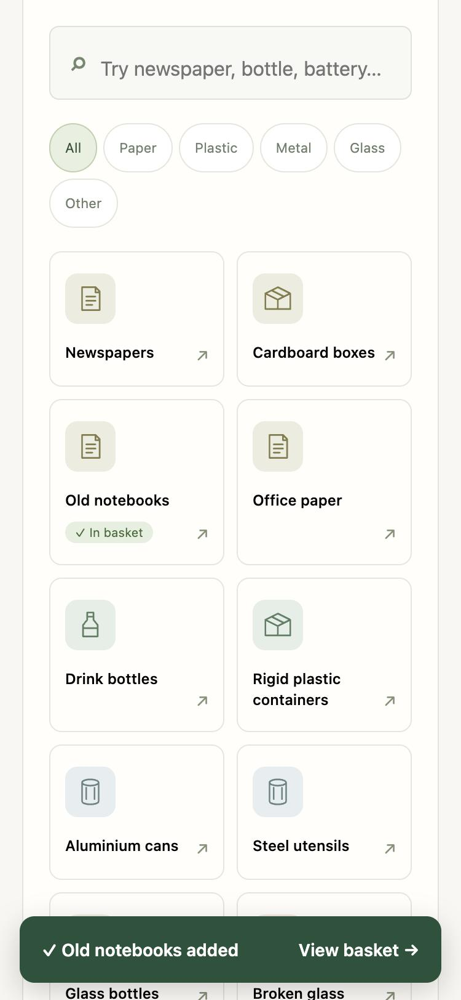
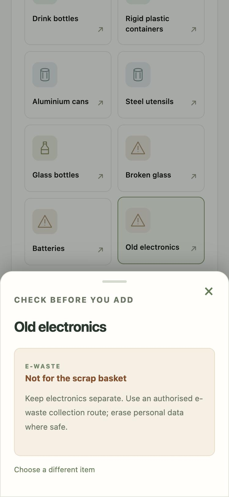
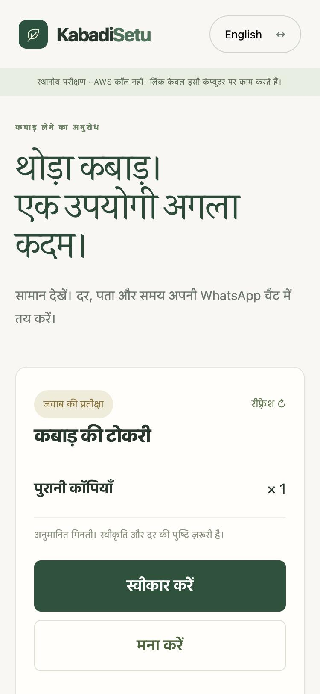
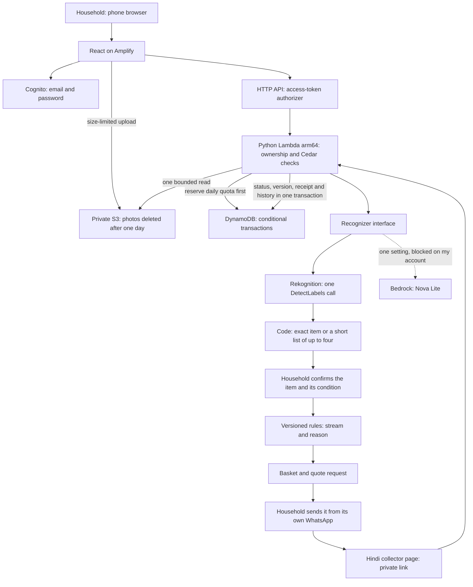

<h1 align="center">KabadiSetu · कबाड़ी सेतु</h1>

<p align="center">
  <b>The AI names the item. Code decides where it goes. People decide what happens.</b><br>
  Sorting help and kabadiwala pickups for Jaipur homes, in Hindi and English.<br>
  Built for WeMakeDevs × AWS Environmental Hacks · Waste and Energy track.
</p>

<p align="center">
  <a href="https://github.com/Anish033-coder/kabadi-setu/actions/workflows/checks.yml"></a>
  
  <a href="LICENSE"></a>
</p>

<p align="center">
  <a href="https://main.d364mryjpwg6jn.amplifyapp.com/"><b>Live app</b></a> ·
  <a href="#try-it-in-five-minutes"><b>Judge's five-minute tour</b></a> ·
  <a href="#claims-and-the-tests-that-check-them"><b>Claims and proof</b></a> ·
  <a href="docs/architecture.md">Architecture</a> ·
  <a href="docs/decisions/">Decisions</a> ·
  <a href="docs/problem-log.md">Problem log</a>
</p>

<p align="center">
  
  
  <br>
  <sub>Sorting with the basket bar · an item that can't join the basket · the kabadiwala's Hindi page. Captured from the local test build, same code as the live app.</sub>
</p>

## KabadiSetu in 60 seconds

| | |
|---|---|
| **The problem** | Since 1 April 2026, India's Solid Waste Management Rules require every household to separate waste into four streams: wet, dry, sanitary and special care. Most people don't know where a battery, a bulb or a chips packet goes. The sellable part usually reaches the local kabadiwala as a one-word WhatsApp message ("aao") with no items or quantities, so he can't tell whether the trip is worth it. |
| **What it does** | A household identifies an item by photo or search, confirms it, and answers what it can see ("clean and dry?"). Versioned rules give the stream and the reason. Sellable items build a basket; the household sends a clear quote request from its own WhatsApp. The kabadiwala opens a Hindi page with no app or login, accepts, then reports collection. Both sides see the same history. |
| **Who uses it** | Households (email sign-in) and kabadiwalas (a private link, no account). |
| **Built with** | React + TypeScript on Amplify · Python 3.14 on Lambda · DynamoDB · Rekognition · Cognito · Cedar · AWS SAM. Full list: [Tech stack](#tech-stack). |
| **Where the AI sits** | Amazon Rekognition looks at the photo. Code turns its labels into one catalogue item or a short list of up to four, and the person chooses. The model has no tools: it cannot add to a basket, decide a stream or change a pickup. Items sorted before are one tap with no AI call. |
| **What's proven** | Live on AWS in Mumbai. 116 automated tests, including double taps and a cancel racing an accept, run against DynamoDB Local. A measured photo scan costs about $0.0013. |
| **What isn't** | No collector has used it or confirmed rates; every pickup so far is a test. No household timing trials yet. Bedrock is blocked on my account. Details: [Not yet](#not-yet). |

## Try it in five minutes

Open **https://main.d364mryjpwg6jn.amplifyapp.com** on a phone or laptop and **create an account with any email address**. Amazon Cognito emails a code; each account is its own household. Credentials are never committed.

1. Choose Hindi or English. Tap **Old notebooks**, answer **Yes** to "clean and dry?", and add it to the basket. The check opens as a bottom sheet on phones, and the basket bar keeps count.
2. Tap **Old electronics**. It says **Not for the scrap basket** and points to an authorised e-waste route. Batteries, bulbs and medicines behave the same way.
3. Optional: photograph a notebook or bottle under **Identify from a photo**. You'll get the item or a short list to choose from (five scans per household per day).
4. Open **Your basket**, prepare the pickup request and read the message. Use the recipient test page instead of messaging a real person.
5. On the Hindi collector page, tap **Accept**, then **Report collected**. Refresh the household page to see the history. This is a test report, not verified collection.
6. Back on sorting, Old notebooks is now under **Your usual items**: one tap, no AI call.

## How it works



### Tech stack

| Part | Built with |
|---|---|
| **Frontend** | React 19, TypeScript 5.9, Vite 8 and plain CSS. Hindi and English built in. No UI library, so the app stays small on slow phones. |
| **Sign-in** | Amazon Cognito, called directly over its HTTPS API (no Amplify SDK). |
| **Backend** | Python 3.14 on AWS Lambda (arm64), AWS Lambda Powertools for routing and logs, boto3. The same code runs on a laptop for local testing. |
| **Access rules** | Cedar policies through `cedarpy`, checked against a schema. |
| **Data** | Amazon DynamoDB (one table, conditional transactions). Sorting rules live in a versioned catalogue, [`data/catalogue.json`](data/catalogue.json). |
| **Photos** | The browser shrinks each photo to 1024 px and re-saves it as JPEG, which drops metadata such as GPS. Pillow checks it again on the server; Amazon Rekognition suggests what it shows. |
| **Messaging** | WhatsApp click-to-chat links (`wa.me`), sent from the household's own phone. |
| **Infrastructure** | AWS SAM (CloudFormation), Amplify Hosting, S3, SSM Parameter Store, CloudWatch, AWS Budgets. |
| **Testing** | pytest (109 tests) with DynamoDB Local in Docker; Node's built-in test runner (7 frontend tests); TypeScript type checks. |
| **CI** | GitHub Actions: Python and frontend tests, IAM policy checks, DynamoDB Local integration and the production build. |

### AWS services, and why each one

| Service | What it does here | Why this one |
|---|---|---|
| **AWS Amplify Hosting** | Serves the React app with strict security headers | Static hosting with no servers to run |
| **Amazon Cognito** | Household email sign-up and sign-in | Managed accounts; SMS login would need Indian DLT registration |
| **Amazon API Gateway** (HTTP API) | Checks Cognito access tokens before any request reaches code | Cheapest API type, with a built-in JWT authorizer |
| **AWS Lambda** (Python 3.14, arm64) | Rules, ownership checks, Cedar policies, pickup lifecycle | One Python backend runs locally and on Lambda; arm64 is cheaper |
| **Amazon DynamoDB** | Baskets, requests, quotas; status, version, receipt and history change together | Conditional transactions make double taps and races safe without Step Functions |
| **Amazon S3** | Private photo uploads | Size-limited presigned uploads; a lifecycle rule deletes photos after a day |
| **Amazon Rekognition** | Suggests what a photo shows | Works on my India-billed account; about $0.00125 per image |
| **AWS Systems Manager Parameter Store** | Holds the secret that signs collector links | Kept out of code and the template |
| **Amazon CloudWatch** · **AWS Budgets** | Logs kept 14 days; alerts at $1, $5 and $10 | Cost and behaviour stay visible |
| **AWS SAM** (CloudFormation) | Defines everything above in [`template.yaml`](template.yaml) | One reviewable deploy |
| Amazon Bedrock | Adapter written and tested, switched off | Every call refused on my account ([problem log](docs/problem-log.md)) |

Authorisation uses [Cedar](https://www.cedarpolicy.com), AWS's open-source policy language ([`policies/access.cedar`](policies/access.cedar)).

## Evidence in numbers

| 116 tests | ≈ $0.13 | 12 of 19 | 1 day |
|---|---|---|---|
| 109 backend (races run on DynamoDB Local) + 7 frontend | per 100 photo scans at Mumbai prices; manual sorting costs almost nothing ([cost](docs/cost.md)) | catalogue items in a fresh test of 30 public photos where the right item was offered; Rekognition alone named 3, none wrong ([evaluation](eval/INTERNET_PHOTOS.md)) | how long a photo lives in S3 |

## Claims and the tests that check them

Each row names the test that would fail if the claim were false. Tests are in [`tests/`](tests); run one with `.venv/bin/python -m pytest -k <test name>`. In rows marked †, the workflow tests also run against DynamoDB Local (`make local-db`), not only in memory.

| Claim | Test |
|---|---|
| A double tap on Accept gives one result, not two † | `test_simultaneous_duplicate_action_returns_one_result`, `test_accept_then_collect_and_duplicate_accept` |
| A cancel racing an accept has exactly one winner † | `test_accept_cancel_race_has_one_winner` |
| Another household can't read, change or analyse your data † | `test_other_household_cannot_read_or_change`, `test_another_household_cannot_analyze`, `test_cedar_rejects_other_owner` |
| A collector link can't cancel the request, and dies when cancelled or expired † | `test_pickup_token_does_not_authorize_household_cancel`, `test_cancellation_revokes_link`, `test_expired_link_fails_even_while_record_exists` |
| E-waste, batteries, medicines and other unsupported items never enter the basket † | `test_items_outside_ordinary_scrap_never_enter_the_basket`, `test_unsupported_and_unconfirmed_items_cannot_be_smuggled_into_basket` |
| The AI never decides a route; it can only offer catalogue items | `test_material_question_is_saved_without_deciding_a_route`, `test_short_list_is_catalogue_scoped_and_capped`, `test_invalid_model_output_falls_back` |
| Daily caps are reserved before a paid call, even under races | `test_daily_reservation_limits_calls`, `test_global_cap_race_never_exceeds_one_call`, `test_concurrent_analysis_calls_model_once` |
| A failed model call is never retried automatically (it might be billed) | `test_ambiguous_failure_is_saved_without_retry_or_refund` |
| An accepted pickup gets its own seven-day window † | `test_accepted_request_can_be_collected_after_the_reply_window`, `test_accepted_request_expires_after_the_pickup_window` |
| Uploads are size-bounded; photos carrying metadata such as GPS are rejected | `test_upload_policy_is_size_bounded_and_exact_key`, `test_metadata_rejected` |
| The Lambda's permissions stay scoped to this project | `test_source_and_transformed_iam_are_scoped`, `test_detect_labels_exception_cannot_widen` |

Not tests, but checkable: photo deletion is the S3 lifecycle rule in [`template.yaml`](template.yaml); the short list was designed on development photos only and frozen in commit `c720603` before the held-out run ([decision 008](docs/decisions/008-short-list.md)).

## What works, what doesn't yet, what we cut

Checked against the live app on 10 October 2026.

### Works

- Live in Mumbai: sign-up and sign-in, manual sorting with versioned rules, baskets, pickup requests, the Hindi collector page (accept, report collected) and shared history.
- Photo identification with Rekognition, under daily caps of five per household and fifty for the app, ending in an exact item or a short list.
- Hindi and English across the main flow; a phone layout with a bottom sheet and basket bar.
- No-AI shortcuts for items a household has sorted before.
- Budget alerts, 14-day logs, security headers and CORS limited to the app's own address.

### Not yet

- **No collector has used it** or confirmed rates or minimum quantities, so the app asks for a quote. Every pickup so far is a test.
- **No household timing trials** yet; the protocol is built in (`?trial=1`, [timing trials](docs/timing-trials.md)).
- **Photo accuracy is measured on public photos only.** In a fresh test of 30 public photos (19 of them catalogue items), Rekognition named 3 items on its own and never a wrong one; with the short list, the right item was offered for 12 of 19. Snack wrappers are never in the list, and 9 of the 11 unsupported items still got one, so "None of these" stays on screen. I also tried it on photos from my home ([evaluation](eval/INTERNET_PHOTOS.md)).
- **Bedrock is blocked** on my India-billed account; a support case is open.
- A collection report is not proof of recycling, and a collector link is not identity verification.

### Cut, and why

- **Strands Agents:** one model call with no agent loop needs no framework ([decision 004](docs/decisions/004-direct-recognition.md)).
- **Step Functions:** DynamoDB conditional transactions already express the pickup lifecycle.
- **WhatsApp Business API:** the household sends from its own WhatsApp, so nothing is sent without it and no business verification is needed.
- **SMS login:** Indian SMS requires DLT registration.
- **Reserved Lambda concurrency:** the account limit is ten ([decision 003](docs/decisions/003-aws-profile-and-concurrency.md)).
- **Collector minimums in the basket:** no validated data, so a quote request instead.
- **Maps, ward dashboards, embeddings, AgentCore:** out of scope for four days.

## Hard questions

**What if the AI is wrong?** It never acts. It suggests; the person confirms; code decides the stream. "None of these" is always on screen, and unsupported items cannot enter the basket whatever the photo says.

**Why not just ask a model which bin?** The rules are new and must be explainable. A versioned catalogue gives the same answer and reason every time, and each rule note can be checked ([`data/catalogue.json`](data/catalogue.json)).

**Why Rekognition instead of Bedrock?** Bedrock refused every call on my account (`Operation not allowed`, in every region I tried). Recognition sits behind one interface, so switching took one setting and no redesign. The Bedrock adapter is still here, tested.

**Why WhatsApp links instead of an app for the kabadiwala?** Kabadiwalas already use WhatsApp. A link opens a Hindi page with two buttons: no install and no password.

**What does it cost?** One measured photo flow costs about $0.00129, 97% of it the image request; manual sorting costs about $0.000001 ([cost](docs/cost.md)). Daily caps are reserved before any paid call.

## Run it locally

Python 3.14, Node 22.13+ and Docker Desktop. From the project root:

```sh
python3.14 -m venv .venv
.venv/bin/python -m pip install -r backend/requirements.txt -r requirements-dev.txt
make local-db
TABLE_NAME=kabadi-setu-local DYNAMODB_ENDPOINT=http://127.0.0.1:8000 .venv/bin/python -m backend.local
```

No Docker? `LOCAL_MEMORY=1 .venv/bin/python -m backend.local` keeps everything in memory. Then, in another terminal:

```sh
cd frontend && npm ci && npm run dev
```

Open http://127.0.0.1:5173. Local mode uses temporary sessions instead of Cognito and makes no AWS calls. WhatsApp sharing is off locally because another phone can't reach a loopback address.

Tests: `make test` (start `make local-db` first, or the DynamoDB cases are skipped, and a skipped run is not database validation), then `cd frontend && npm test && npm run build`.

## Deploy to your own AWS account

1. Use a non-root AWS session; `make preflight` checks it without changing anything.
2. Install AWS SAM CLI. `make build` uses the Linux arm64 build container.
3. Deploy [`infra/budget.yaml`](infra/budget.yaml) as a separate stack with your `AlertEmail` and confirm all three alerts. An alert is not a spending cap.
4. Create the link secret once with `make secret`. Rotating it invalidates existing collector links.
5. `make deploy`, review the change set, and set `AllowedOrigins` to your exact frontend address.
6. Put the stack outputs in `frontend/.env.local` (see `.env.example`), then publish with `scripts/deploy_frontend.py`.
7. Check sign-in, cross-household denial, link expiry and the full request flow before enabling recognition (`RecognitionEnabled=true`, `RecognitionProvider=rekognition` or `bedrock`).

## Repository

```text
backend/        Python API: rules, workflow, recognition, Cedar checks (same code locally and on Lambda)
frontend/       React + Vite app, Hindi and English
data/           catalogue.json: 18 items, streams, guidance and rule notes
policies/       Cedar policies and schema
tests/          pytest suites, including races against DynamoDB Local
eval/           photo tests and results
infra/          budget stack · template.yaml at the root defines the app
docs/           architecture, decisions, costs and problem log
scripts/        deploy, demo user, cost and evaluation helpers
```

## Authorship

Developed by Anish Kumawat for WeMakeDevs × AWS Environmental Hacks (Waste and Energy track). AI assistance, as the rules require: **Codex** and **Claude**.

## Licence

[MIT](LICENSE) © 2026 Anish Kumawat. Dependencies keep their own licences; the TrashNet evaluation photos are MIT-licensed and credited in [`eval/`](eval).
