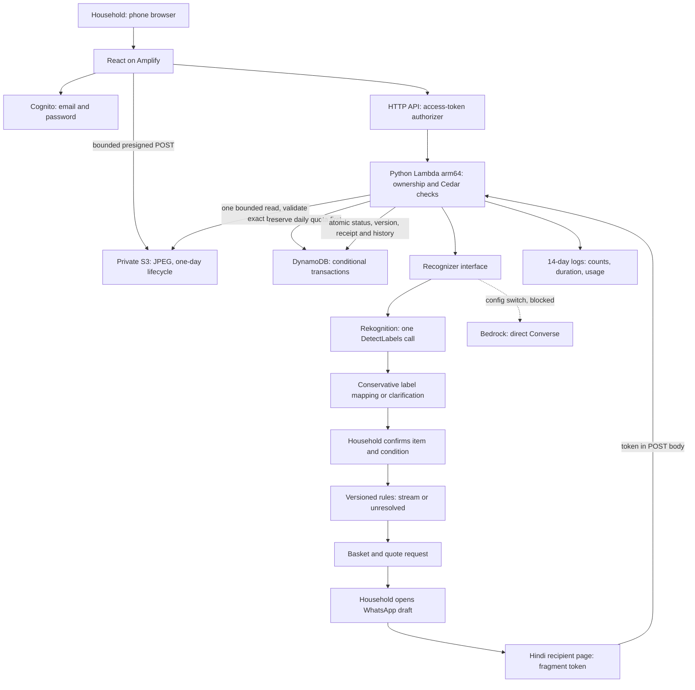

# Architecture

**The AI names the item. Code decides where it goes. People decide what happens.**

One Python backend runs locally and on AWS. DynamoDB Local exercises the same transactions; an in-memory adapter is only for previews/unit tests. SAM container builds produce Linux arm64 native dependencies. The frontend is manually deployed; GitHub pushes remain paused.

The AI cannot run tools or change a basket/request. Generic bottle/can labels do not prove material. Clarification always offers manual selection. Rules use the human-confirmed item and visible condition; unresolved items remain unresolved. Mapping `.3` is a post-benchmark UX change, not yet evaluated; the published held-out results belong to `.2`.

Household ownership comes from the verified access token's `sub`. Recipient links are scoped capabilities, not proof of a person's identity. Tokens stay in the URL fragment and are submitted in the body; GET does not change status. Version checks and action receipts protect repeated taps and conflicting updates. Expiry is checked by the application; DynamoDB TTL deletion is asynchronous.

Photos are re-encoded in the browser, uploaded to a private exact key and read once. The backend validates bounded JPEG bytes before reserving inference quota, then passes those same bytes to the provider. Saved analysis is reused for the same scan. Separate scans of identical bytes are not yet deduplicated. Daily quotas and no automatic inference retries limit exposure; budget alerts do not enforce a hard spending cap.

Recipient pages use no-store, no-referrer and frame-protection headers. There is no collector login, messaging automation, delivery receipt or verified recycling claim. Rates and minimums have not been validated with a Jaipur collector. The working flow requests a quote and records reported actions.
